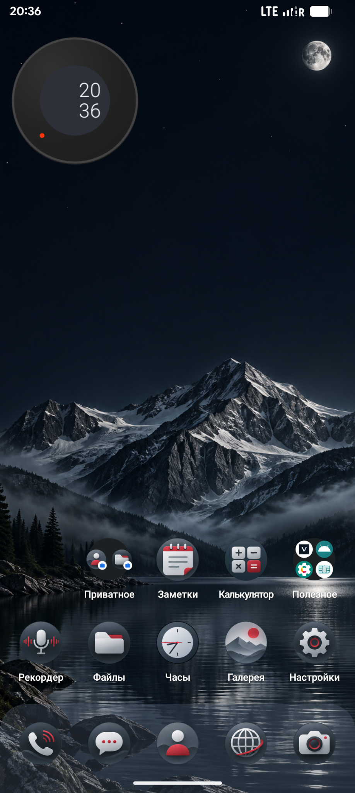
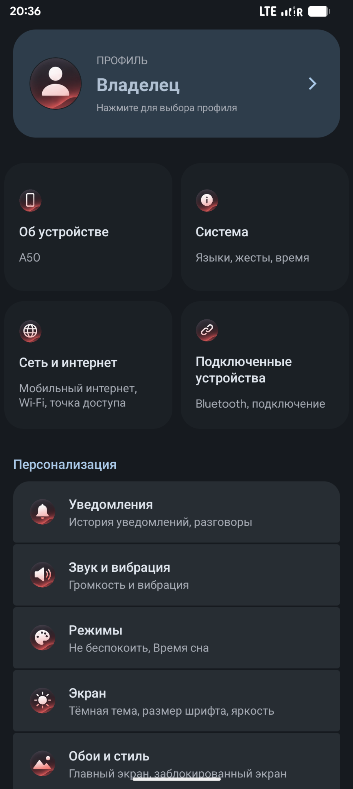
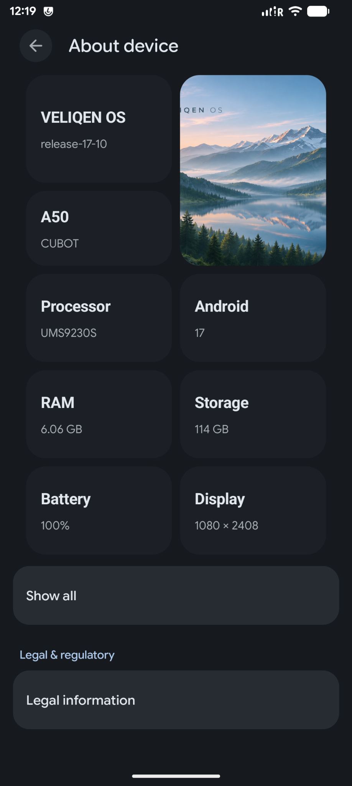
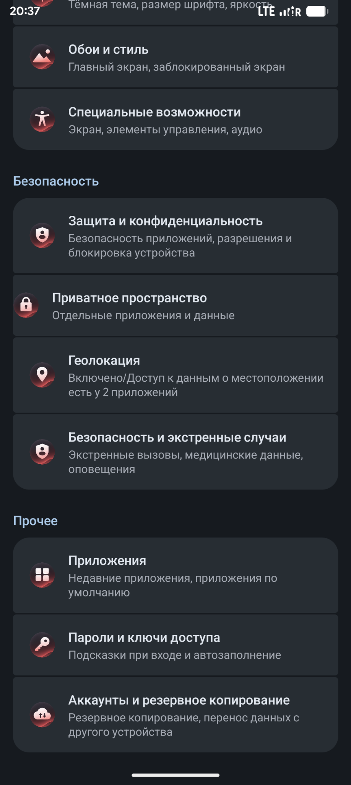

# VELIQEN OS

A new Android operating system experience.

### Official website
https://veliqen.tech

### Video presentation
[Watch VELIQEN OS presentation](demo.mp4)

© VELIQEN OS

<!-- VELIQEN_RELEASE_BEGIN -->

## VELIQEN OS 17 — microG Edition

**Android 17 · LineageOS-based GSI · ARM64 · ext4 · Beta**

VELIQEN OS is a custom Android GSI focused on a minimal interface, mountain-inspired visuals and redesigned system experiences. This build is the **microG edition** (not a Google Play / certified GApps build).

### Preview

  
  
  
  

### Release

- **Version:** `17-01.1BETA-aizner`
- **Download:** [VELIQEN OS 17 microG Beta](https://github.com/eyzner/VELIQEN-OS/releases/tag/v17-01.1BETA-aizner)
- **Format:** `system.img` (ARM64 GSI, ext4), distributed as compressed multipart archives
- **Screenshots:** captured on Cubot A50

> **Beta software.** This is a system image, not a complete device firmware package. Flashing requires a compatible Treble device and an unlocked bootloader. Back up personal data and original partitions first. Compatibility, calling, camera, encryption and other hardware features may vary by device. No Google Play certification is claimed.

### Важно

Это тестовая ARM64 GSI-прошивка на Android 17 с microG. Перед установкой сохраните резервные копии и убедитесь, что устройство совместимо с данным типом GSI. Скриншоты сделаны на Cubot A50.

<!-- VELIQEN_RELEASE_END -->
