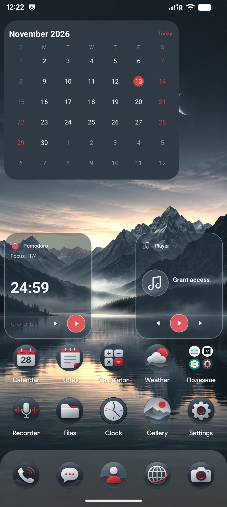
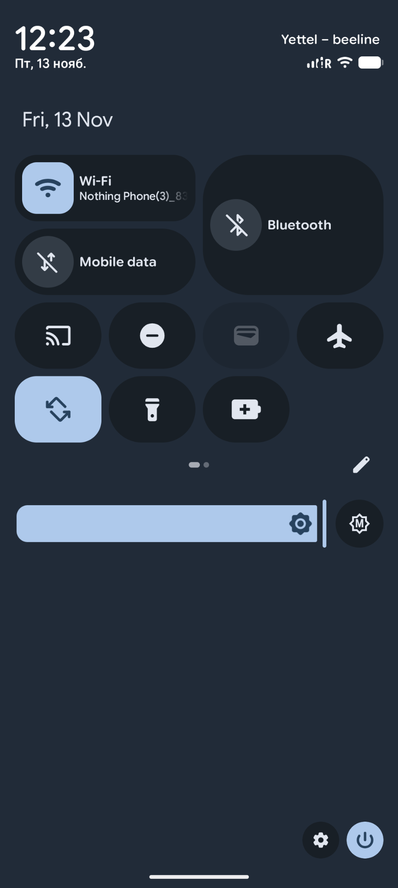
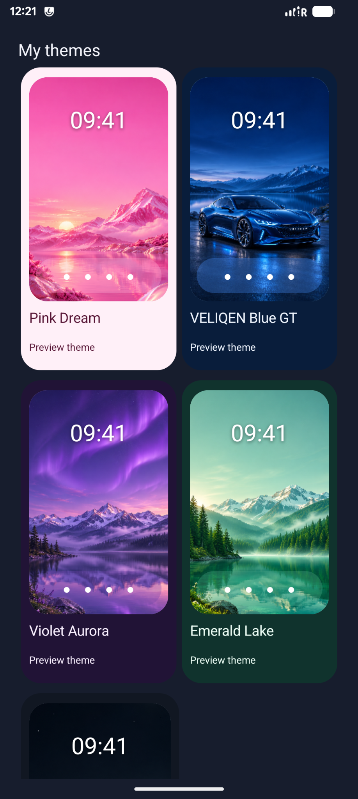
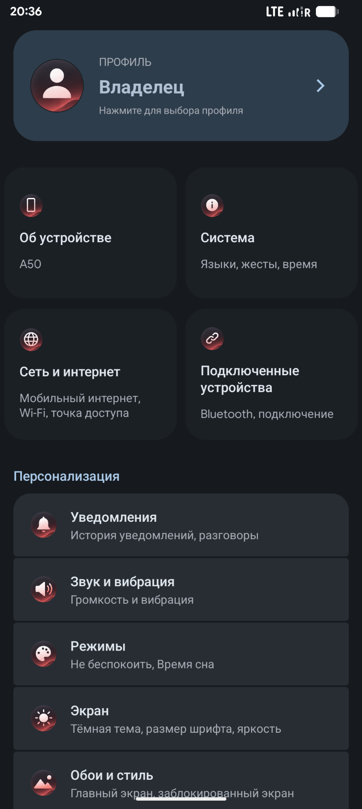
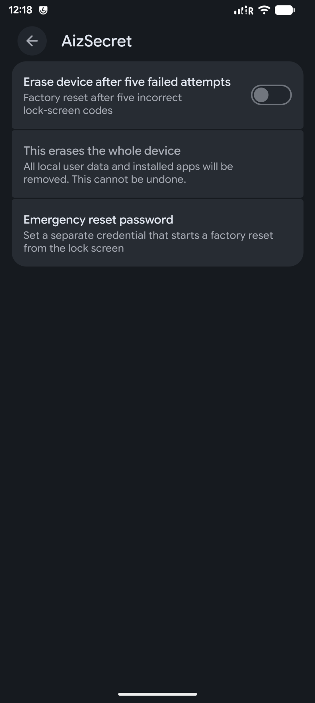
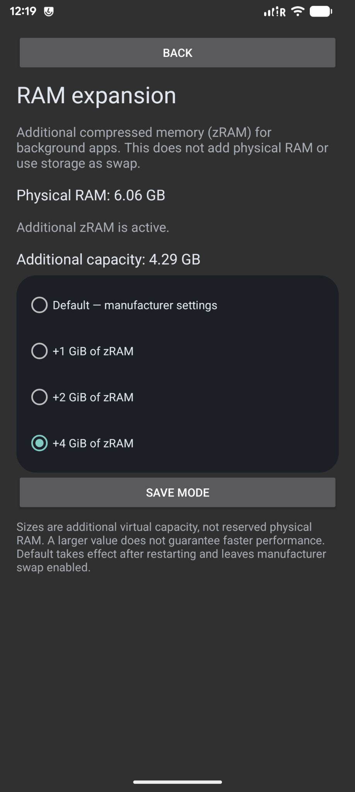
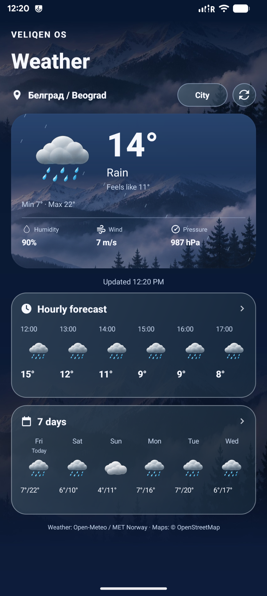
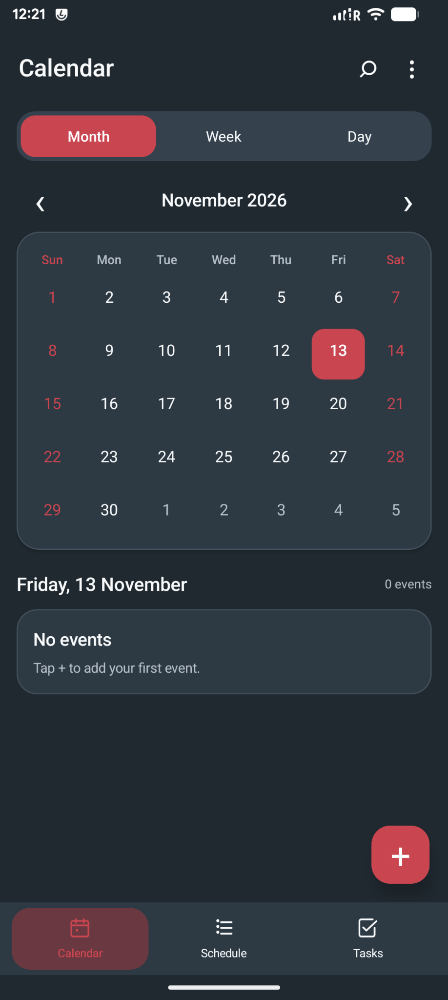
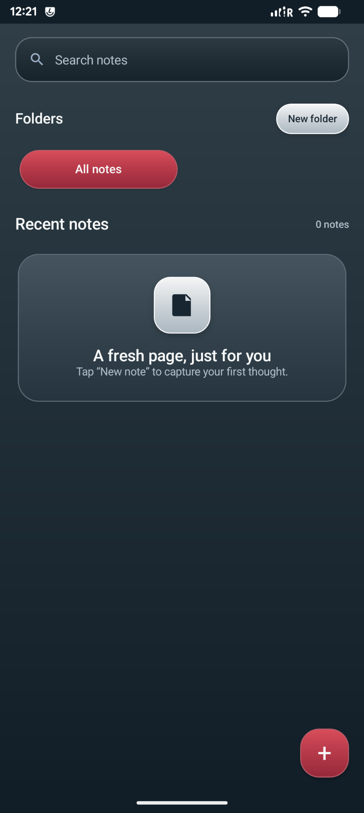

# VELIQEN OS

VELIQEN OS is an Android 17-based system for ARM64 devices. It puts apps, folders and widgets directly on the home screen and gives Settings, Quick Settings and the built-in apps a shared look.

**[Download VELIQEN OS 17-11](https://github.com/eyzner/VELIQEN-OS/releases/tag/release-17-11)** · [Screenshots](#screenshots)

## First setup

The edition picker, where included, lets you choose **GApps** for Google apps and services, **microG** for microG services, or **Vanilla** for a setup without either. Make your choice during the initial setup.

## AizSecret

AizSecret lets you set an optional emergency password. Entering that password on the lock screen triggers a full factory reset. You can also enable a separate option to reset after five incorrect unlock attempts.

**A reset permanently erases local user data and installed apps.**

## Around the system

- Private space keeps its apps and data separate. Kids mode only opens apps approved by a parent.
- The launcher has its own theme picker, a translucent dock and room for calendar, weather and productivity widgets.
- Quick Settings groups Wi-Fi, mobile data and Bluetooth at the top.
- Weather, Calendar, Notes and Calculator share the VELIQEN design.
- RAM expansion adds configurable compressed memory through zRAM.

## Downloads

Choose one ARM64 system image from [the release page](https://github.com/eyzner/VELIQEN-OS/releases/tag/release-17-11).

| Archive | System partition |
| --- | --- |
| `VELIQEN-EXT4-ARM64.zip` | ext4 |
| `VELIQEN-EROFS-ARM64.zip` | EROFS, for devices that support it |

Extract the ZIP to get the image. To check a download on Linux, put `SHA256SUMS` next to the ZIP and run `sha256sum --ignore-missing -c SHA256SUMS`.

## Screenshots

| Home screen | Quick Settings | Themes |
| :---: | :---: | :---: |
|  |  |  |

| Settings | AizSecret | RAM expansion |
| :---: | :---: | :---: |
|  |  |  |

| Weather | Calendar | Notes |
| :---: | :---: | :---: |
|  |  |  |

[More screenshots](screenshots/)
