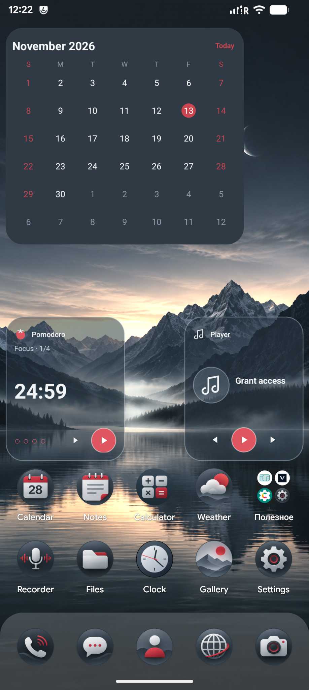
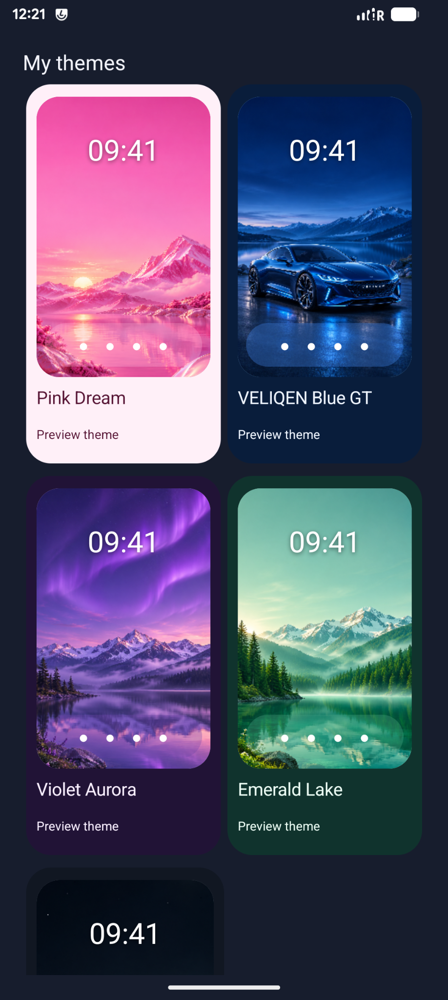
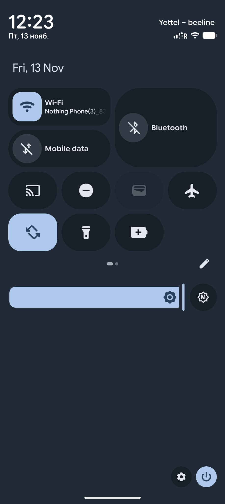
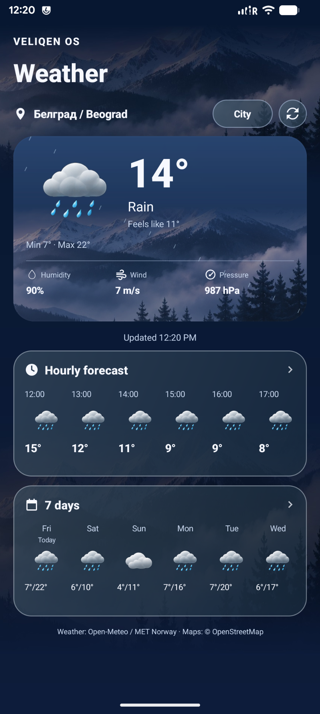
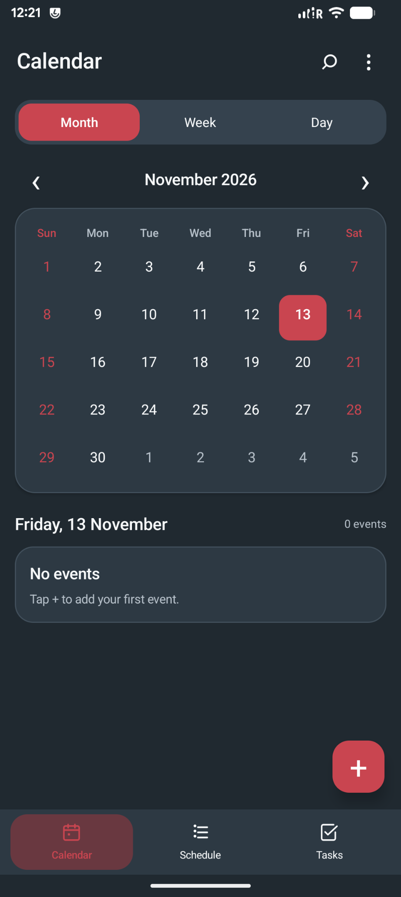
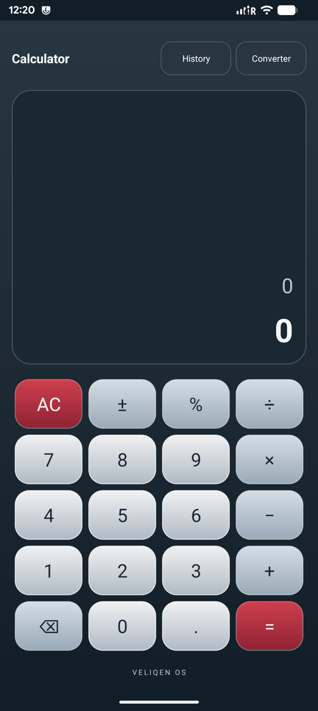
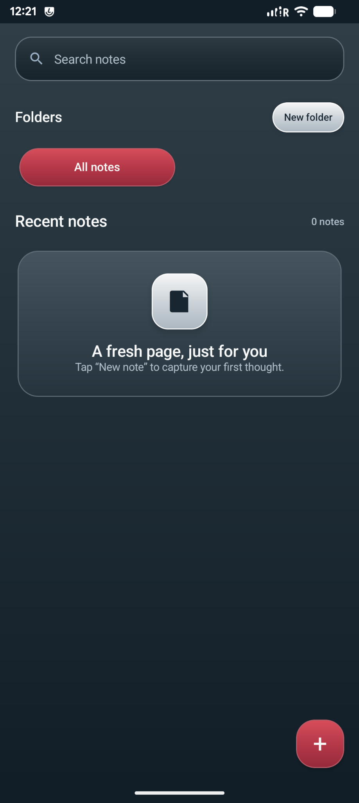
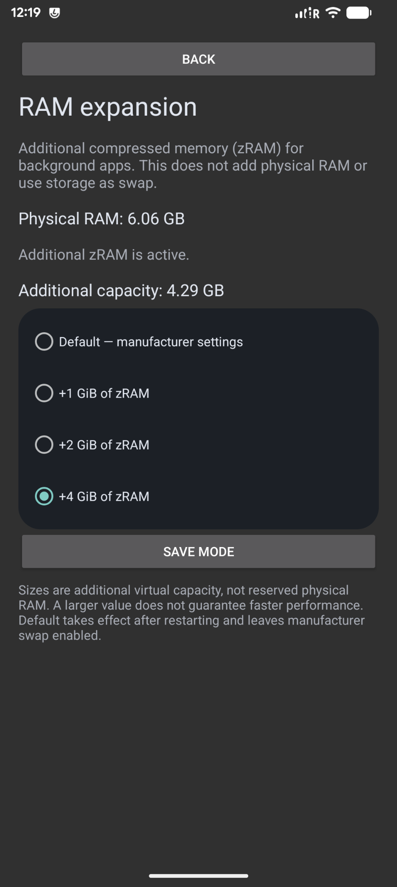
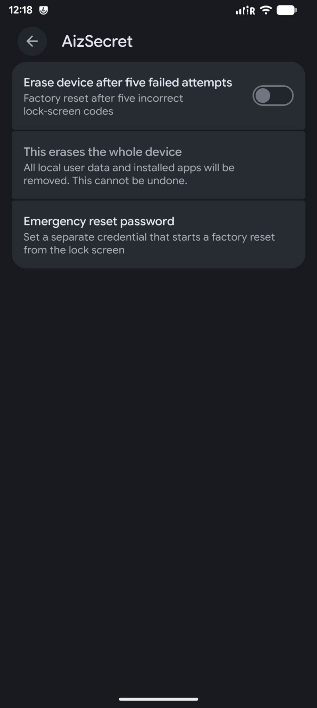

<div align="center">

# VELIQEN OS
### Android 17 · release-17-10 · by Aizner

**A distinctive Android experience, shaped around a calmer home screen and a coherent visual style.**

[Download latest release](https://github.com/eyzner/VELIQEN-OS/releases/latest) · [Screenshots](#screenshots) · [Русский](#русский)

</div>

---

## English

VELIQEN OS is a custom Android 17 system with a redesigned launcher, system settings, quick controls and a collection of apps styled to work together.

### What’s inside

| Home and personalization | System tools | Everyday apps |
|:--|:--|:--|
| Home pages with app icons, folders and widgets | Redesigned Settings and About device | Weather with hourly and 7-day forecasts |
| Translucent dock and circular icon style | Quick Settings with large connectivity controls | Calendar, Notes and Calculator |
| Pink Dream, VELIQEN Blue GT, Violet Aurora and Emerald Lake themes | Private space and Kids mode entries | Refreshed Messaging appearance |
| Calendar and productivity widgets | Optional AizSecret reset controls | RAM expansion through configurable zRAM |

RAM expansion offers additional compressed-memory capacity; it does not add physical RAM. AizSecret can erase local user data when its explicitly enabled reset conditions are met. Read each setting carefully before enabling it.

### Screenshots

| Home screen | Themes |
|:--:|:--:|
|  |  |

| Quick Settings | Settings |
|:--:|:--:|
|  |  |

| Weather | Calendar |
|:--:|:--:|
|  |  |

| Calculator | Notes |
|:--:|:--:|
|  |  |

| About device | RAM expansion |
|:--:|:--:|
|  |  |

| AizSecret |
|:--:|
|  |

### Download

Open [Releases](https://github.com/eyzner/VELIQEN-OS/releases) and download the latest system image and its `SHA256SUMS` file. Verify the download before use:

```bash
sha256sum -c SHA256SUMS
```

The release image is compressed as `.img.xz`. Extract it with:

```bash
unxz -k VELIQEN-OS-release-17-10-arm64-system.img.xz
```

Screenshots show VELIQEN OS release-17-10 running on a Cubot A50.

## Русский

VELIQEN OS — кастомная система на базе Android 17 с переработанным рабочим столом, настройками, шторкой быстрых действий и приложениями в едином стиле.

### Что входит

| Рабочий стол и оформление | Системные функции | Приложения |
|:--|:--|:--|
| Страницы рабочего стола со значками, папками и виджетами | Переработанные настройки и экран «Об устройстве» | Погода с почасовым и семидневным прогнозом |
| Полупрозрачная нижняя панель и круглые значки | Новая раскладка быстрых переключателей | Календарь, заметки и калькулятор |
| Темы Pink Dream, VELIQEN Blue GT, Violet Aurora и Emerald Lake | Разделы приватного пространства и детского режима | Обновлённое оформление сообщений |
| Виджеты календаря и продуктивности | Настраиваемое стирание данных через AizSecret | Расширение ОЗУ с помощью zRAM |

Расширение ОЗУ использует сжатую память и не добавляет физическую ОЗУ. При включении AizSecret заданные условия сброса приводят к удалению локальных пользовательских данных. Внимательно прочитай описание перед включением.

### Скриншоты

Скриншоты выше показывают рабочий стол, темы, шторку, настройки, погоду, календарь, калькулятор, заметки, сведения об устройстве, расширение ОЗУ и AizSecret.

### Загрузка

Открой раздел [Releases](https://github.com/eyzner/VELIQEN-OS/releases) и скачай свежий образ системы и файл `SHA256SUMS`. Проверь файл после загрузки:

```bash
sha256sum -c SHA256SUMS
```

Образ опубликован в формате `.img.xz`. Распаковать его можно командой:

```bash
unxz -k VELIQEN-OS-release-17-10-arm64-system.img.xz
```

Скриншоты сделаны на Cubot A50 с VELIQEN OS release-17-10.

---

<div align="center">VELIQEN OS · Aizner</div>
